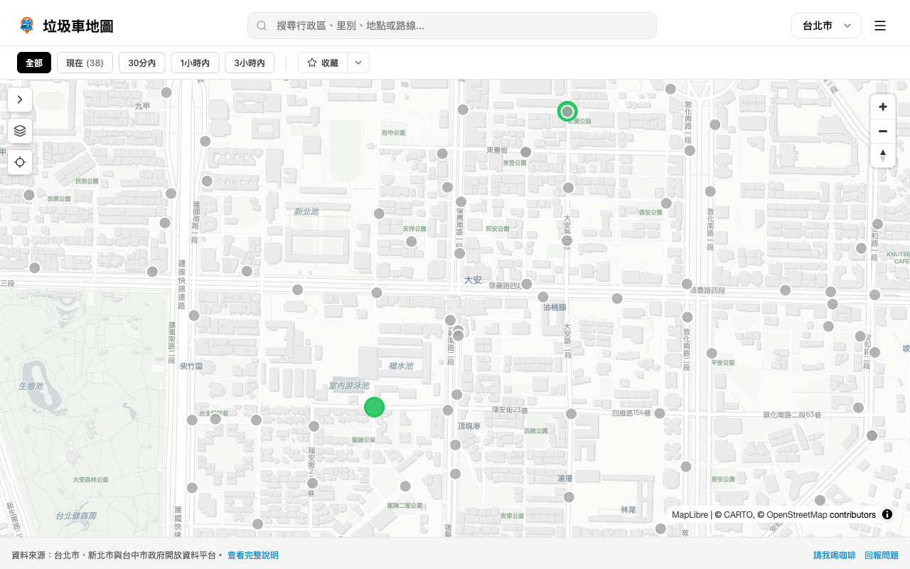

# 垃圾車地圖 · Taiwan Garbage Truck Map

[](https://garbage.yukai.dev)
[](https://mcp.garbage.yukai.dev)
[](LICENSE)

**Find out when the garbage truck reaches your street.** An interactive map of garbage and recycling truck stops and arrival times for Taipei, New Taipei, Taichung and Kaohsiung — works on your phone, installs like an app, and keeps working offline.

台北市、新北市、台中市、高雄市的垃圾車與資源回收車停靠點與抵達時間地圖，可安裝成 App、離線可用。

**👉 https://garbage.yukai.dev**



## Features

- **See who's coming next** — filter stops by *now*, *within 30 min*, *within 1 hour* or *within 3 hours*.
- **Search** by district, village, road or route, e.g. `大安區`. Searches are linkable: `?q=大安區`.
- **Favorites** saved on your device, and **share a stop** with a link (`?point=…`).
- **Truck routes** drawn along real roads for supported routes.
- **Dark mode** and a satellite layer.
- **Installable & offline-friendly (PWA)** — add it to your home screen; city data is cached and refreshed in the background.

## Supported cities

| City | Source | Weekly schedule |
|---|---|---|
| 台北市 Taipei | [data.taipei](https://data.taipei) | – |
| 新北市 New Taipei | [data.ntpc.gov.tw](https://data.ntpc.gov.tw) | ✅ garbage / recycling / food scraps |
| 台中市 Taichung | Taichung City open data, geocoded with TGOS | ✅ |
| 高雄市 Kaohsiung | [data.kcg.gov.tw](https://data.kcg.gov.tw) | – |

Data is refreshed automatically every month. Your city missing, or a stop wrong? [Open an issue](https://github.com/Yukaii/garbage/issues) — city requests are triaged automatically.

> Stop times come straight from each city's published open data and can change without notice. Treat them as a guide, not a guarantee.

## For AI agents: MCP server

The same data is available to AI assistants through a read-only [Model Context Protocol](https://modelcontextprotocol.io) server — no API key.

```json
{ "mcpServers": { "taipei-trash": { "url": "https://mcp.garbage.yukai.dev/mcp" } } }
```

Then ask things like *"When does the garbage truck come near 25.033, 121.543?"*. Tools: `list_cities`, `find_nearby_points`, `search_points`, `get_schedule`. See [`mcp/README.md`](mcp/README.md). Agents can also start from [`/llms.txt`](https://garbage.yukai.dev/llms.txt).

## Development

Built with React 19, Vite, MapLibre GL, Tailwind and Bun.

```bash
bun install
bun run dev         # Vite dev server
bun run typecheck   # tsc --noEmit
bun run build       # production build -> dist/
```

`public/*.json` is dumped from the `data` branch (`bun run dump-data`, needs a local `data` branch).

### How it fits together

- **Web app** (this repo) → GitHub Pages at `garbage.yukai.dev`.
- **Data** → an orphan `data` branch refreshed monthly by GitHub Actions and shipped with each deploy.
- **Routes** → built weekly with Valhalla from the stop sequences.
- **MCP server** → [`mcp/`](mcp/), its own Vercel project that reuses the app's city adapters.

Contributor and agent conventions, and how to add a city, are in [`AGENTS.md`](AGENTS.md). Deeper notes live in [`docs/`](docs/).

## Credits

- Created by [Yukaii](https://github.com/Yukaii), with contributions from [PastLeo](https://github.com/pastleo).
- Map data © [OpenStreetMap](https://www.openstreetmap.org/copyright) contributors, tiles © [CARTO](https://carto.com/attributions), rendered with [MapLibre](https://maplibre.org).
- Collection data belongs to the respective city governments and is used under their open-data terms.

## License

[MIT](LICENSE) for the code. Data remains under each city's open-data terms.
